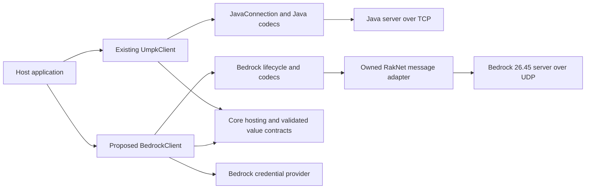
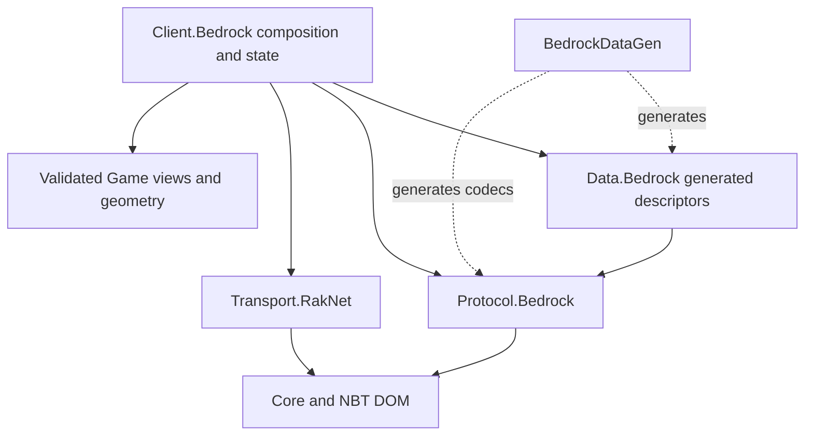
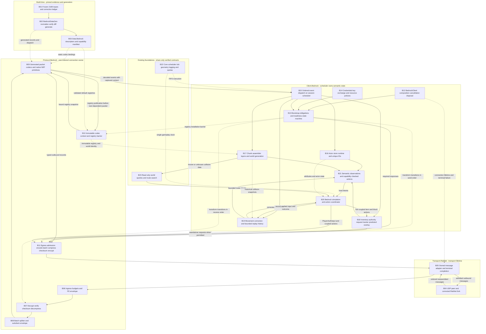
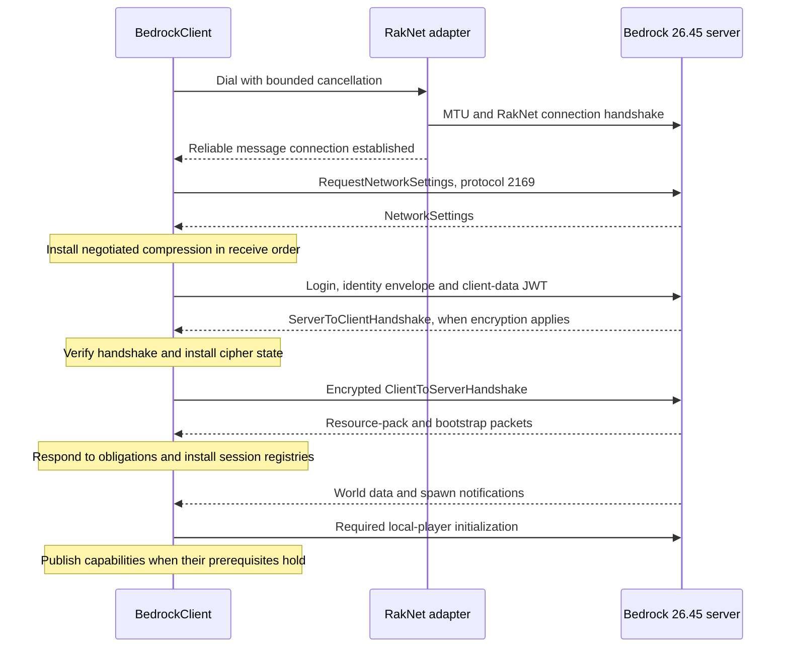

# UMPK: Bedrock 26.45 architecture proposal

Research date: 13 September 2026 · Target: marketed release **26.45**, dataset **1.26.45**, network protocol **2169** · Scope at research time: client library architecture. Current implementation progress is recorded in the linked plan.

## Summary

Bedrock support is feasible. Add a sibling Bedrock transport, protocol, and client stack; preserve the existing Java API and share only foundations whose contracts fit both editions. The supplied RakNet library passed an isolated Linux x64 Native AOT publish and fragmented-message loopback, but needs transport correctness work before adoption. The supplied 2169 dataset needs field-level reconciliation against the exact codecs and packet evidence. Identical 2168/2169 schemas alone do not establish an error: the inspected server also reuses the base codec. Gate each capability on its required evidence while transport and independent subsystems proceed in parallel.

## Scope, evidence, and confidence

This proposal targets ordinary direct connections to a vanilla Bedrock Dedicated Server (BDS), initially one local player per connection. Hosted discovery, NetherNet/signaling, Realms, split-screen subclients, Education, server implementation, and protocol translation are separate capabilities. Packet fields needed to reject or preserve those distinctions still belong in the wire model. Full gameplay automation is a later acceptance milestone, not a consequence of reaching spawn.

**Verified** below means inspected source/data or an explicitly recorded execution. **Recommendation** means an architectural conclusion. **Unresolved** means the evidence does not establish the behavior. Community schemas and implementations describe their own behavior; an exact 26.45 vanilla exchange remains the interoperability oracle. No Java behavior is assumed equivalent merely because a type or feature has the same name.

| Source | Inspected revision and role |
|---|---|
| UMPK | `509694de2ad8ba4a0d550da2466a7fb148226d17`; clean starting checkout; current ownership, APIs, and implementation. |
| Supplied minecraft-data | `8ee2fbe890949fe6c2cf037cd50007ef50444931`; clean `umpk-contributions` branch in the user's fork, with PrismarineJS upstream; primary packet/data source. |
| Supplied RakNet, now the user’s MCCTeam fork | `673b6fc737ee4273f05a7fbf2a99bc87311a1517`; clean `main`, origin `https://github.com/MCCTeam/RakNet`; tracked source unchanged after recloning. Primary .NET transport source. |
| Supplied PowerNukkitX | `f325c30eb75ae869f3f0652d464526de7c0c9877`; clean `beta`; explicitly selects 1.26.45/2169; server lifecycle, chunk writer and mapping-loader reference. |
| Supplied Geyser | `d50a5ffbd8a6924ad52cf4c211600e8ca24c7c3d`; clean checkout; explicitly registers 26.45/2169; translation and session-state reference. |
| Supplemental Cloudburst Protocol | `db36d289968a1d07d6591f0d54426cc058b227c0`; pinned source near Geyser’s timestamped dependency build; exact source-to-binary identity was not established. |
| Supplemental PrismarineJS/bedrock-protocol | `05940d77bee67b96395c69afb57b92e32bea4148`; declares current version 1.26.45; connection/authentication/transform implementation. |
| Supplemental Sandertv/gophertunnel | `b8bd7357c24fcba3e32f940d1afb1d3b4e43b96d`; declares 1.26.45 and 2169; independent framing and crypto cross-check. |

The supplied [version.json][D-version] identifies 2169 and release type `release`. Mojang's [26.45 announcement][M-release] dates the hotfix to 20 August 2026, and its [2169 changelog][M-2169] identifies `r/26_u4 hotfix 5`. The documentation portal currently displays a newer preview in its navigation; that header must not override the version stated in an older changelog's body.

## Feasibility and constraints

### What UMPK already provides

`Umpk.Core.GameVersion` already includes `GameEdition.Java` and `Bedrock`; retain this identity. The rich `JavaVersion`, `IVersionCatalog`, `ProtocolDescriptor`, and phase registries remain Java-specific. `PacketTimeline` selects an implementation at a known protocol boundary, and `PacketCodecContext` deliberately carries bound registries rather than a version integer. These are useful design patterns for a separate Bedrock catalog. They do not make unknown future versions safe. [GameVersion][U-version] · [JavaVersion][U-java-version] · [PacketTimeline][U-timeline]

`UmpkClient` is explicitly a Java session. `ConnectCoreAsync` constructs `JavaConnection` and `DescriptorFrameCodecBinding`, then invokes `JavaClientLogin`. Its builder requires `JavaVersion`; `IConnectionFactory` returns `IDuplexPipe`. `JavaConnection` owns Java stream framing, compression, encryption, and phase changes. A RakNet-to-pipe adapter alone would therefore enter the wrong wire stack. [UmpkClient.cs:340][U-client] · [IConnectionFactory.cs:5][U-transport] · [JavaConnection.cs:13][U-connection]

Useful shared foundations include `ISessionScheduler`'s FIFO execution contract, `ITickSource`, logging, cancellation/resource ownership, geometry, and selected registry mechanics. The important registry invariant is installation before dependent decoding; Java even has a JoinGame registry-update exception outside configuration. Reuse that ordering guarantee without imposing Java's configuration phase on Bedrock. [ISessionScheduler][U-scheduler] · [PacketCodecContext][U-context]

### Java and Bedrock cannot share these implementations directly

| Area | Verified UMPK contract | Bedrock 2169 evidence and design consequence |
|---|---|---|
| Lifecycle and identity | Java handshake/login/configuration; session join uses `serverIdHash`; `GameProfile` and one access token. | Network settings precede Login; certificate/multiplayer-token/client-data artifacts and a separate key exchange follow. Create Bedrock credentials and bootstrap states. Keep connected, authenticated, world-known, spawned, and ready distinct. |
| Serialization and NBT | Java `PacketReader` uses Java numeric/string encodings. `NbtWireFormat` contains three Java root forms; `NbtReader` is big-endian and `ModifiedUtf8` is Java-specific. | Mixed endianness, unsigned variable integers, signed ZigZag, presence fields, network NBT, item little-endian NBT, and loose NBT sequences require explicit Bedrock codecs. Share the tag DOM and quota concepts where valid. [NBT sources][U-nbt] |
| Actors | `Entity.Id` is `int`, with UUID; `EntityStore` indexes both. | Actor runtime IDs are generally unsigned 64-bit; unique IDs are signed 64-bit; only player identity adds UUID. Removal uses unique ID. Preserve both namespaces and their session lifetime. [Entity.cs:20][U-entity] · [AddEntity schema][D-actors] |
| Items and inventories | `ItemStack` carries Java data components; `InventoryState` has 46 player slots, window 0, a 15-bit state-ID ring, and click prediction. | ItemV4, stack network IDs, full/dynamic container identity, correlated item-stack requests/responses, and embedded use actions need Bedrock models and reconciliation. Java click counters/slot numbers are not substitutes. [InventoryState.cs:8][U-inventory] · [ItemV4][D-item] |
| World storage | `ChunkSection` has one block palette, 4³ biome cells and Java palette widths; `BitStorage` uses padded 64-bit words. | Use a Bedrock subchunk assembler/store with storage layers, runtime palettes, block actors, request state, and explicit unknown terrain. The community packet schema leaves subchunk payload packing opaque. [ChunkSection][U-chunk] · [LevelChunk][D-chunk] |
| Movement and physics | `MovementReporter` emits Java input/position variants; `PhysicsEngineHolder` binds `PhysicsProfileFactory.FromJavaVersion`; `PlayerPhysics` uses Java-derived behavior. | PlayerAuthInput couples input, prediction, ticks, and actions; corrections require history/replay. Share geometry and validated query interfaces, then build/prove Bedrock simulation. Never pass 2169 into a Java profile factory or assume retuned constants are sufficient. [PhysicsEngineHolder][U-physics] · [PlayerAuthInput][D-movement] |
| Capabilities and plugins | `ClientActionCapabilities` inspects Java `WireIndex`; `ClientPluginContext` exposes `UmpkClient` and Java packet handlers/custom payloads. | Share supported semantic actions only through new narrow contracts. Existing plugins and Java command-tree/Brigadier adapters are not automatically portable; Bedrock has its own command, text, and form packets. [ClientActionCapabilities][U-capabilities] · [ClientPluginContext][U-plugin] |

### Exact-version data needs a reconciliation gate

Verified: `data/dataPaths.json` resolves 1.26.45 to frozen `protocol.json`, but its YAML `proto` and `types` resolve to `bedrock/latest`. Blocks, block states, collision shapes and items come from 1.26.30; entities from 1.21.80; recipes from 1.19.10; windows from 1.16.201; materials/effects from Java `pc/1.17`. This is upstream data reuse, not proof of either correctness or error for 26.45. Record and validate each source independently. [dataPaths.json:2977][D-paths]

The 2168 and 2169 compiled protocol files are byte-identical, with 429 type entries each. This does **not** establish staleness. PowerNukkitX constructs its 2169 codec from base 2168 and keeps a separate 2168 hotfix-4 codec for 26.44; its selection uses protocol number plus Login GameVersion. The independently inspected Cloudburst 2169 codec likewise extends base 2168. Treat release/build, packet dialect, network protocol and data/behavior profile as distinct identities. For this delivery, select only the explicit 1.26.45/2169 profile; future same-number dialects need evidence and deliberate selection rather than a fallback to the newest codec. [PNX version selection][PNX-versions] · [PNX selector][PNX-select]

Mojang’s 2169 changes remove a nested `Line Gap Height` field from PrimitiveShapes text data and an **extra** optional tag around `RemoveScore::Objective Name`. The PrimitiveShapes packet remains. The supplied ShapeText already omits the removed field, and PowerNukkitX constructs the corresponding six-field text model. A single optional objective marker can remain after an extra nested marker is removed; the exact serializer comparison below resolves that distinction. Validation and skin-enum changes still need their own witnesses. [2169 changes][M-2169] · [PNX text model][PNX-text-shape]

### What the new server and proxy sources establish

PowerNukkitX’s checked-in `src/main/resources/mappings/` contains three files: `blocks.json` (32,366 entries), `biomes.json` (65) and `level_sound_id_map.json` (564). Its block loader parses Java blockstate keys, normalizes Bedrock properties and substitutes air for unresolved nonexperimental mappings; reverse mapping can collapse several Java states. These are translation aids, not canonical lossless Bedrock state. Preserve unknown states in UMPK. Native block/item/biome palettes instead come from `org.powernukkitx:gamedata:r-26_u4-SNAPSHOT`; the checked-in mapping directory does not contain that complete dataset. [Java-state parser][PNX-je-state] · [Mapping loader][PNX-map-loader] · [Dependencies][PNX-deps]

PowerNukkitX directly implements useful network terrain bytes: its subchunk writer emits version 9, two storage layers and section Y; palettes use padded 32-bit little-endian words, followed by VarInt palette counts/values. It advertises block-network IDs as hashes and hashes little-endian NBT containing the full block name and sorted, typed state properties using FNV-1a/32. Block actors use the network NBT writer. Network and storage palette writers are separate. This establishes an implementation reference for the opaque minecraft-data chunk payload, not permission to hardcode two layers or copy storage-only shortcuts into a network decoder. Its singleton writer is incomplete, so V0 needs another byte witness. [Section writer][PNX-section] · [Palette writer][PNX-palette] · [Chunk body][PNX-chunk-body] · [Hash bytes][PNX-hash]

PowerNukkitX’s packet serializers mostly belong to `org.powernukkitx.protocol:bedrock-connection:3.0.0.Beta7-Debug-SNAPSHOT`, whose exact resolved artifact was not obtained. Its packet-model Java types therefore cannot settle field widths or optional markers. Geyser supplies an independent path to inspect Cloudburst serializers; do not describe that source as PowerNukkitX’s resolved dependency. Record origin, resolved artifact hash and license/notices for every imported source or dataset. PNX declares LGPL-3.0; its JSON mappings have no per-file provenance manifest. Referencing behavior does not require copying its implementation or silently changing its license. [Dependency declarations][PNX-deps] · [PNX license][PNX-license]

### Field-by-field 2169 reconciliation

Geyser registers `Bedrock_v2169.CODEC` for 26.45 and pins Cloudburst artifacts to `3.0.0.Beta13-20260824.114016-17`. The exact Maven source artifacts returned HTTP 403; the inspected Cloudburst commit precedes that build timestamp by 19 seconds. Its relationship to that binary is a plausible inference, **not a proven artifact match**. The following facts are verified against the identified source, whose v2169 codec explicitly selects the base v2168 serializers. They materially improve implementation guidance while leaving exact BDS acceptance separate. [Geyser selection][GY-version] · [Dependency pin][GY-deps] · [2169 codec][CB-version]

| Field / discrepancy ID | Source-verified disposition | Implementation consequence |
|---|---|---|
| D01 — base 2168, hotfix-4 and 2169 | 2169 extends base 2168. Hotfix-4 has a separate SetScore override. [Codec selection][CB-version] · [Hotfix dialect][CB-hotfix] | Identical base schema files are consistent with these implementations. Model explicit dialect/profile identity; do not invent a blanket correction. |
| D02 — RemoveScore objective | Base/2169 has one optional-objective boolean; hotfix-4 adds a second boolean when present. [Base serializer][CB-score] · [Hotfix serializer][CB-hotfix-score] | The supplied optional field is corroborated. Removing the extra nested tag does not make the objective unconditional. |
| D03 — PlayerAuthInput | Presence boolean, VarUInt count, then signed ZigZag VarInt enum ordinals; tick uses unsigned VarLong. [Selected serializer][CB-input] | Preserve the optional list and its order/presence, separately from later nested action-section flags. A legacy input bitmask would be wrong. |
| D04 — ItemV4 | Network-stack form uses signed i16LE runtime ID and u16LE count, with context-specific additional IDs/NBT. Item-instance form instead uses signed VarInt IDs. [Helper][CB-helper] | The surprising widths are corroborated. Generate separate item forms and bind shield/user-data context from item definitions. |
| D05 — metadata and stack requests | Metadata has an outer VarUInt discriminator plus u8 format; requests have outer VarUInt plus inner u8 action type. Request-slot stack network IDs use fixed i32LE. [Metadata][CB-metadata] · [Actions][CB-actions] · [Slot IDs][CB-slotids] | Preserve duplicate-looking bytes and per-field ID encoding. Explicitly validate consistency where the field contract requires it; do not copy unchecked reads merely because a reference accepts them. |
| D06 — MovePlayer | Cloudburst uses unsigned VarLong for actor runtime ID, riding runtime ID and tick. The supplied data declares different signed/fixed-width actor-ID forms. [Serializer][CB-move] | A concrete conflict remains. Put these exact fields in a reviewed correction overlay with independent vectors/capture witnesses; never narrow IDs or copy an old codec unchanged. |
| D07 — chunk envelope | LevelChunk has optional-limit presence and an unconditional blob-count field. SubChunk entries carry independent optional payload/heightmaps/hash fields. [LevelChunk][CB-chunk] · [SubChunk][CB-subchunk] | The newer presence fields are corroborated. Avoid old count-sentinel layouts and cache-dependent omission of blob count. Body palette packing remains a distinct native codec. |
| D08 — `varint128` prediction flags | The selected `MovementPredictionSync` serializer encodes a separate unsigned large flag bitset. Cloudburst has 131 EntityFlag entries, including bits 128–130, so the profile occupies 19 seven-bit bytes even when all flags are zero. [Packet serializer][CB-prediction] · [Bitset helper][CB-largeflags] · [Flag enum][CB-flags] | The undeclared community primitive needs a bounded native mapping. **A .NET UInt128 is too narrow.** Record the 131-bit logical width separately from the encoded-byte limit and preserve unknown bits. Keep this bitset distinct from D03’s input list. The packet direction and three prediction-sync floats remain unresolved, so registration and reconciliation stay blocked pending exact 2169 traffic. |
| D09 — validation and remaining primitives | Skin enums, resource-response wire details, unknown StartGame values, prediction-sync semantics and singleton/other chunk forms still need targeted exact-version witnesses. | Track each obligation’s dependency and status; do not stall unrelated transport, model or codec work, and do not advertise the dependent capability until its gate passes. |

Geyser gives concrete state-boundary examples: per-session mapping/helper installation precedes StartGame encoding; EntityCache keeps separate Java IDs, Bedrock runtime IDs and UUID mappings; inventory responses preserve request IDs and check stack-network IDs. Its PlayerAuthInput translator processes embedded actions in input order before emitting a Java tick-end packet. These support separate UMPK stores and one action timeline. They do **not** supply native Bedrock rewind: corrections and collision handling serve a Java-authoritative downstream session. Geyser also overrides packet policy, including rejecting SubChunkRequest in its server-facing role. Neither its packet allowlist nor its Java fallbacks belong in a native BDS client. [Entity namespaces][GY-entity] · [Inventory correlation][GY-inventory] · [Input ordering][GY-input] · [Codec policy][GY-policy]

Geyser’s mapping gitlink is pinned, but the supplied checkout was uninitialized; only its pinned README/license were inspected. That README names Java 26.2 / Bedrock 1.26.30.5 generation. Its code license is MIT and Cloudburst’s is Apache-2.0; the mapping notice limits MIT to work its contributors can license. Keep code, extracted-data and per-session-registry provenance distinct. This study does not claim to have audited the full missing mapping payload. [Mapping provenance][GY-mappings]

### RakNet integration and Native AOT

Verified: `ArkMirage.RakNet` targets .NET 10, has no package references, and uses the MIT license. `Dialer.DialContext` implements client MTU discovery/open connection and the connected handshake. `Conn.Write(byte[])` defaults to reliable ordered delivery; `ReadPacket()` returns a complete reassembled message. The implementation uses RakNet protocol 11, a separate number from Bedrock 2169. Actual 26.45 BDS negotiation remains untested. [RakNet project][R-project] · [Dialer.cs:139][R-dialer] · [Conn.cs:206][R-conn]

| Transport issue verified in source | Required disposition before adoption |
|---|---|
| `ElasticChan(4,4096)` actually blocks at four entries and never grows. The same receive path handles transport traffic. | Fix queue/backpressure behavior below the adapter; prove overload behavior and continued ACK/control progress. |
| Client `LimitsEnabled()` returns false, bypassing receive/ordering/split limits; fragment count drives allocation. | Enforce byte/count/window/lifetime bounds before allocation and fragment assembly. A Bedrock packet-length limit is too late. |
| Ordered channel is hardcoded to 0; only `ReliableOrdered` takes the ordering path; sequenced behavior is incomplete. | Claim only proven delivery modes. Establish exact required channel/reliability behavior with target captures. |
| Blocking reads lack caller cancellation; deadline APIs throw; receive/send paths suppress some failures; shutdown does not expose thread joins. | Add awaitable completion, strict errors, cancellation and disposal ownership in upstream or an audited fork. A wrapper alone cannot fix hidden parser failures. |
| Client uses receive and maintenance threads; DNS chooses its first result and default socket is IPv4. | Prove bounded shutdown and target address families; measure many-client overhead before generalizing. |
| Send counters wrap at 24 bits while receive windows/ordered queues use linear comparisons; ACK range parsing has inclusive-budget and tag-validation gaps. | Add bounded modular sequence arithmetic, separate reliable-message deduplication, and strict ACK expansion tests across wrap. |
| Dial/receive paths do not consistently bind responses to the expected endpoint; retry loops can survive exceptional exits. | Validate peer and handshake fields, ignore unrelated-source datagrams without disrupting a valid peer, and cancel/await every owned retry loop. |

Evidence: [ElasticChan.cs:24][R-queue], [Handler.cs:20][R-handler], [Conn.cs:398][R-receive], [Packet.cs:91][R-packet], [Dialer.cs:239][R-errors]. RakNet maintenance timers own ACK/retry/keepalive; the session tick remains the sole locomotion clock. UDP has no TCP-style EOF: closure tests must check peer-observed disconnect/timeout and local socket/thread reclamation. Use monotonic elapsed time for retries, fragment expiry, inactivity and shutdown, keeping wire timestamps separate.

**Fork strategy:** the replacement clone is `MCCTeam/RakNet`, still at the exact previously inspected commit and tree. Use it to stage small generic fixes for upstream: lifecycle/completion, parser bounds, sequence windows, fragment accounting and nonblocking control progress. Keep wire widths and identifiers unchanged; bounds must not silently evict accepted reliable or unacknowledged messages. Add APIs where practical and inventory any breaking changes. These fixes are useful beyond Bedrock and are intended to preserve RakNet interoperability; upstream acceptance and actual compatibility still require review and independent-peer tests. Bedrock batching, crypto, login and game ticks remain above the adapter. See [ACK parser][R-ack], [datagram window][R-window] and [ordered queue][R-order].

**Executed AOT result:** an isolated `/tmp` test assembly compiled the unchanged complete RakNet source with `IsAotCompatible=true`; a test app rooted the whole assembly for trimming/AOT analysis. SDK 10.0.112, runtime/AOT packs 10.0.12, `linux-x64`: native publish passed with no IL/AOT diagnostics. The native executable passed IPv4 discovery, dial/accept, and a 5,000-byte fragmented reliable-ordered echo in both directions. Cookies were disabled. This supports AOT feasibility for this transport revision, not production readiness or whole-stack compatibility.

Strict warnings-as-errors compilation failed on nine ordinary C# warnings (CS0114, CS8604, CS8618). Publication under upstream's ordinary-warning policy retained ILLink/ILC warnings as errors. Those C# warnings need correction for UMPK's contract. Shipping UMPK projects already set `IsAotCompatible=true`; retain generated registration and source-generated JSON. Future Bedrock crypto, compression, JWT/token handling and generated codecs each require rooted whole-stack publish/run tests per supported RID. [UMPK build policy][U-aot] · [Microsoft library AOT guidance][MS-aot]

## Proposed architecture

### Package and ownership boundaries

Proposed names below describe responsibilities; none of these new packages or types has been implemented. Add four core sibling projects and a data-generation tool. Keep authentication and initial Bedrock physics in cohesive internal modules until separate consumers justify further packages.

| Proposed component | Owns | Dependency direction |
|---|---|---|
| `Umpk.Transport.RakNet` | Audited RakNet adapter, owned messages, delivery contract, bounded I/O and terminal completion. | Core infrastructure plus pinned RakNet; no Java or gameplay references. |
| `Umpk.Protocol.Bedrock` | Bedrock reader/writer, packet records, NBT wire adapters, header/batch transforms, descriptors, codec context and protocol obligations. | Core, NBT DOM, proven Game value types; no dependency on Client or Data.Bedrock. |
| `Umpk.Data.Bedrock` | Generated immutable `BedrockVersion` descriptors, registry/default data and provenance manifest. | Protocol.Bedrock; mirrors Data.Java's consumer-to-protocol direction. |
| `Umpk.Client.Bedrock` | `BedrockClient`, bootstrap/readiness, actor/world state, inventory, movement history, semantic capabilities, composition. | Protocol.Bedrock, Data.Bedrock, Transport.RakNet and validated shared foundations. |
| `tools/Umpk.BedrockDataGen` | Import/resolve/verify/diff/generate commands and custom-type validation. | Build-time schema compiler; no ProtoDef interpreter in shipping code. |

Keep `UmpkClient` and current builder/plugin interfaces as the Java compatibility surface. Initially expose `BedrockClient` separately. Extract a common observation/capability facade only when both implementations establish a useful contract; migrate Java internally without requiring consumer rewrites. Preserve existing Java package references and defaults, including `ServerEndpoint`'s 25565 default; give Bedrock an explicit endpoint/default port instead. Keep `Umpk.Server` and `Umpk.Proxy` reserved. Do not make adding Bedrock depend on a repository-wide client rename.





The first diagram shows runtime flow; the second shows consumer-to-dependency arrows, with dotted generation arrows. Put a small message-connection contract in `Umpk.Core.Transport`, with no edition phases or RakNet types, and bind it at composition so protocol tests need no UDP. Ordinary send completion means acceptance into a bounded queue; expose terminal connection completion separately. It does not mean peer delivery or server application acceptance. Transfer outbound buffer ownership only on successful admission; retain caller ownership on rejection. The receiver owns and disposes each delivered message. Serialize writes through one connection-owned transform path, because compression activation and cipher counters depend on order.

### Detailed implementation map

The following map is the working component contract for implementing agents. All `Bxx` components are proposed; the identifiers stay stable when class names change. Solid arrows carry runtime data or commands; dotted arrows carry build output, captured context or lifecycle control. The package diagram above remains the authority for project references. Update the Mermaid source, this boundary table and the implementation plan together when a boundary changes.



| Boundary | Owner and implementer contract |
|---|---|
| B01–B03: evidence to generated code | DataGen owns the normalized schema, per-field evidence, correction preconditions, hashes and deterministic output. Runtime code consumes static descriptors; it never discovers codecs through reflection or resolves `latest`. |
| B04–B05: transport to message connection | RakNet owns ACK/retry/reassembly and monotonic transport deadlines. The adapter owns buffer transfer and terminal completion. Enforce fragment and queue bounds inside the fork before allocation; publish no RakNet types in shared contracts. |
| B06–B11: bytes to records and back | The connection owns transform state, counters, codec context and ordered writes. Admission reserves capacity before cipher state advances. Invalid transform state is terminal. A record encoder and decoder use the same bound version profile without exposing a version integer to gameplay code. |
| B10/B13/B15: registry and lifecycle barrier | Bootstrap specifies obligations; the connection publishes immutable decode context before the next dependent record, including within a batch. Scheduler commits semantic state in order. Barrier code must not await an event that requires the receive loop to advance. |
| B16/B17: observations | Actor IDs retain both namespaces. Chunk assembly captures registry identity, dimension and world generation; late work cannot mutate a replacement world. Expensive decoding uses bounded work queues and ordered commits if profiling justifies it. |
| B18/B19/B20: one action timeline | Inventory owns request correlation and authoritative reconciliation. Movement owns correction history; simulation consumes one session tick and reports applied input. The action coordinator serializes embedded inventory/block actions with that tick and prevents duplicate replay side effects. |
| B21–B23: public and shared surface | Hosts see immutable observations, supported commands and explicit unavailable data/capabilities. Pathfinding consumes validated world queries; Java movement execution and packet APIs remain edition-specific. |
| B12: lifetime | One composition root owns cancellation, readiness tasks, resource disposal and terminal failure propagation. Disconnect, respawn and dimension change have different scopes; each cancels only its owned pending work. |

### Bedrock wire stack and connection flow

Verified in two implementations declaring 1.26.45: a game-packet header is a VarUInt32 with a 10-bit packet ID and two 2-bit subclient fields. A batch concatenates VarUInt32 lengths and complete packet bytes. The RakNet application message has a clear `0xFE` prefix. Keep subclient fields in the envelope; initially reject unsupported nonzero routing rather than folding it into packet IDs. [Gophertunnel header][G-header] · [Batch encoder][G-encoder]

After network settings, compression tags are `0x00` raw DEFLATE, `0x01` Snappy, and `0xFF` uncompressed. This is not Java's zlib-wrapped compression. Honor negotiated state/thresholds; if an algorithm is not implemented, reject it explicitly. Prismarine's encrypted path currently hardcodes DEFLATE and its Snappy paths throw; those are implementation limitations, not proof that the protocol lacks Snappy. [Prismarine framer][P-framer] · [Prismarine encryption][P-encryption]

Key exchange uses P-384 ECDH and `K = SHA256(salt || rawECDHSharedSecret)`. Modern encryption uses a continuous AES-256-CTR stream, starting at `K[0:12] || 00 00 00 02`, with separate state per direction. For each encrypted batch body `P` (compression tag plus compressed/plain batch), append `SHA256(LE64(batchCounter) || P || K)[0:8]`, then encrypt; exclude the clear `0xFE`. The batch counter is distinct from AES's block counter and from the gameplay tick. [Key exchange][P-key] · [CTR initialization][G-encoder] · [Checksum][G-checksum]

Prismarine calls Node's GCM cipher incrementally without GCM tags/finalization; gophertunnel expresses the corresponding CTR stream directly. Ordinary .NET `AesGcm` record encryption would produce the wrong wire format. Build a small explicitly stateful transform and prove it with independent multi-batch vectors, partial-block boundaries, corruption and replay/order cases. Receive order is **decrypt → verify checksum → decompress → split → decode**, with bounds at each allocation point. Checksum, decompression, framing and invalid transform-transition failures terminate the connection. Never retry advanced cipher state, reset counters mid-session, or fall back to plaintext. The server handshake JWT's self-declared key verifies signature/key binding, not independent trust in the server's identity. Cloudburst independently confirms checksum-before-encryption, but its receive checksum check defaults off; retain mandatory verification in UMPK. [Decoder][G-decoder] · [Cloudburst encoder][CB-encrypt] · [Conditional validation][CB-verify]

Bound queued and unacknowledged message bytes/counts and maximum queue age; reserve capacity before advancing encryption. ACK/retry processing must continue independently of application consumption. If receive saturation cannot be resolved within bounds, terminate rather than discard an encrypted batch and continue with desynchronized cipher state. Enforce cumulative compressed/expanded bytes, member counts, NBT depth/elements/string bytes, pending registry/chunk work and total retained session bytes, including before authentication. Stop decompression as it reaches its output budget.

The Bedrock connection owns ordered transform/decode progression, including an awaited registry-installation barrier **within a batch**. Publish an immutable codec context before decoding a dependent packet. Keep world commits on the session scheduler; callbacks at the barrier must not await work that itself requires receive progression. Expensive chunk work may use a bounded worker queue only after required context is captured, with ordered commits and explicit byte/work limits. Verify tick latency under chunk bursts and slow consumers; do not start with unbounded parallel decoding.



This is an architectural sequence, not a claim of a universal total order for every bootstrap packet. `RequestNetworkSettings` precedes Login in the inspected implementation. Preserve transform changes between packets/batches even if multiple datagrams are already queued; do not decode queued bytes under a later state. [Prismarine client][P-client]

Use a Bedrock credential-provider contract that supplies identity/certificate material, multiplayer token and separately signed client-data JWT, with explicit offline/online modes and key ownership. Share HTTP/cache infrastructure only where appropriate. Java `ISessionAuthenticator.JoinAsync(serverIdHash, ...)` remains Java-specific. Require caller-selected auth mode and never downgrade online failure to offline automatically. Validate applicable issuer, audience, lifetime, algorithm/curve and signature/key binding for each token type; own ephemeral keys and cipher state per connection. Online token claims, refresh, trust anchors and account behavior require dedicated validation; an offline BDS join proves none of them. Generate JSON metadata for auth and skin payloads and keep secrets out of packet logs. [Prismarine authentication][P-auth]

Resource-pack responses are protocol obligations independent of downloading, accepting, caching or hash verification. Keep those actions independently opt-in. Required unsupported content must yield an explicit readiness/failure result. Install ItemRegistry/runtime IDs and custom block/palette context before item/chunk consumers run. StartGame alone does not imply a usable world; readiness should express which registries, local player state, terrain and initialization obligations are complete.

### State, interaction, and physics

Retain edition-specific backing stores. A shared entity handle should include family/session identity without narrowing Bedrock actor IDs into `int` or inventing UUIDs. A shared item view can expose name/count and supported properties while retaining Bedrock runtime/stack IDs and extras. A common world query should return known data or unknown availability; it must never treat an unreceived subchunk as air. Session registry identity, world generation and dimension changes must invalidate pending chunk/inventory work before stale responses can modify the new world.

Use a Bedrock request tracker for full container addresses, authoritative snapshots, predicted overlays, request IDs and rejection. Derive shield-specific extra-data context from the session item registry. Keep catalog IDs, runtime item IDs, stack network IDs and recipe IDs distinct. Common operations such as use, drop or move a stack should advertise actual support; do not expose Java's `ClickAction` as a universal inventory language. [Item/container types][D-item] · [Request/response types][D-requests]

A Bedrock movement controller owns bounded tick-indexed input/state history and applies relevant corrections before advancing simulation. Replay needs the movement-affecting actor/attribute updates and world state relevant to that history, not just a list of positions. Item/block actions carried with PlayerAuthInput must share its tick/ordering boundary. Bound history by retained bytes as well as ticks, cap referenced terrain versions and replay work, and expire outstanding chunk requests. If required historical state is unavailable, use an explicitly validated resynchronization path or terminate with a clear failure; never silently replay against current terrain. Teleports, respawn, dimension changes and history exhaustion need distinct recovery rules. Mojang's [movement guide][M-movement] supports this design; its [block-breaking guide][M-breaking] explains action coupling. Exact replay rules remain a 26.45 validation target.

Reuse `IPhysicsWorldView`, geometry and route-search machinery only after checking their contracts. `PlayerPhysics`, Java collision data and Java path execution cannot be declared Bedrock-correct. Establish measured walking/jumping/collision/fluid behavior before enabling autonomous navigation; separately qualify vehicles and special movement. The dataset supplies shapes and descriptions, not a complete movement integrator. Cache-disabled terrain is a reasonable initial scope if 26.45 BDS accepts it. Later blob caching needs bounded storage, requested-ID correlation and XXHash64 verification. [Mojang cache validation][M-cache]

### Version organization and future additions

Use `data/bedrock/2169/` with a manifest mapping release `1.26.45` to game protocol 2169 and its explicit packet-dialect/data/behavior profile. Keep profile identity in codec bindings and cache keys so a future same-number hotfix need not distort an integer timeline. Pin each resolved input path, revision, hash and validation status. Import at build time; never read mutable `bedrock/latest` at runtime. Keep session-negotiated registries separate from bundled defaults and key shared caches by edition-qualified identity. B2J/J2B mappings can assist a deliberate translation feature but are not lossless shared-state models; neither PNX’s air substitution nor Geyser’s Java fallbacks belong in native Bedrock state.

Produce a canonical normalized schema from immutable vendor inputs plus small reviewed correction overlays. Record exact evidence for every overlay, fail when an overlay no longer applies, and retire it only after reviewing the upstream replacement. Generate deterministically from that normalized input, never from manually edited generated output.

Generate initially internal typed wire records, fixed registration tables and immutable descriptors; handwrite small native primitive/NBT/chunk adapters with byte-level tests. Maintain a per-packet manifest of wire availability, inbound/outbound implementation, required obligations and evidence. Schema presence is insufficient because deprecated packets remain. Unknown enums may be retained as raw values only where the exact field contract permits them; unknown lengths, malformed payloads and unsupported discriminants must not receive blanket leniency. Maintain stable semantic observations/actions by hand. Compatible codecs can share a wire record; incompatible layouts use distinct internal records/adapters without changing an existing public record on each release.

For the first join milestone, generate only the explicitly required packet set and its transitive type dependencies; fail on dangling types or unsupported constructs inside that set. D08 now has a concrete large-bitset implementation reference: map the primitive explicitly, without substituting UInt128, and qualify prediction-sync semantics separately. Record excluded optional packets in the support manifest and expand it with each capability. An unexpected required obligation fails explicitly. Complete-profile generation must resolve the whole supported set.

For the next Bedrock release: resolve its identity, pin inputs, diff packet IDs/layouts/validation and data/behavior axes independently, then reuse unchanged codec steps within the explicit supported catalog. Add new timeline steps only for demonstrated changes and profile strategies for semantic changes. A patch alias is allowed only after compatible artifacts/captures establish it. Do not fork an entire version directory of handwritten codecs or add scattered `if (protocol >= ...)` checks throughout session/game code. Keep required join support, inventory, world decoding, and movement capability status separate from the mere presence of a protocol descriptor.

## Decisions

| Decision | Alternative considered | Rationale and trade-off |
|---|---|---|
| Sibling Bedrock client and stack with incremental shared contracts. | Generalize `UmpkClient`, Java phases and all Game models first. | Preserves Java compatibility and avoids forcing Bedrock into Java semantics; accepts temporary duplication of orchestration. |
| Internal replaceable RakNet message adapter over a pinned, corrected revision. | Fake `IDuplexPipe` transport, or rewrite all RakNet immediately. | Preserves message/delivery ownership and uses demonstrated code; requires upstream/fork maintenance and measured transport fixes. |
| Generated Bedrock descriptors plus explicit native codecs. | Runtime ProtoDef/reflection interpreter or copying every version. | Fits UMPK AOT and boundary-testing patterns; increases build-time tooling and reconciliation work. |
| Bedrock state/physics behind narrow shared views. | Normalize everything into existing Entity/ItemStack/ChunkSection. | Preserves actor identity, layers and transaction semantics; common API scope starts smaller. |
| Gate features by evidence and prerequisites. | Claim complete support once login works or all schema entries generate. | Gives hosts reliable capability answers; requires per-subsystem conformance reporting. |

## Risks and open questions

| Priority | Unresolved question | Proof required |
|---|---|---|
| P0 | Is the 2169 community schema correct at every required boundary? | Close D06 MovePlayer and D08 large-bitset/native semantics, validation and remaining primitive witnesses; preserve the D01–D07 corroborated dialect/field distinctions. Capture exact bytes with decoded assertions and byte-identical re-encoding. |
| P0 | Can the supplied RakNet meet UMPK's failure and resource contracts? | Fix lower-layer bounds/queue/errors; loss, reorder, duplication, sequence wrap, split abuse, timeout and closure tests against independent peers. |
| P0 | Does the full login/crypto/bootstrap work with vanilla 26.45? | Exact BDS build/hash, raw-ECDH and multi-batch crypto vectors, compression activation tests, offline and separately authorized online legs. |
| P1 | Can a Bedrock simulation remain consistent with server correction? | Measured movement/interaction traces, bounded rewind across collision/attribute changes, vehicles and history-exhaustion tests. |
| P1 | Are inherited data, custom palettes and subchunk layers accurate? | Resolve runtime registries and opaque payload packing; test custom dimensions/content, partial terrain, stale replies and known-air distinction. |
| P1 | Are full inventory transactions correct? | Correlated accept/reject traces, simultaneous requests, dynamic containers, crafting and embedded movement actions. |
| P1 | Does Native AOT work for the entire shipping stack on supported platforms? | Rooted full-stack publish and executable runs for required RIDs including crypto/compression/auth; no unreviewed IL warnings. |

When source comparisons leave a correctness question open, capture a controlled exact-build exchange, compare decoded values and state transitions, then use targeted disassembly/debugging of a user-provided matching BDS executable if needed. Such interoperability analysis is available; no binary has been inspected in this study. Keep executable/hash provenance and research traces outside Git, and record the behavioral conclusion and reproducible witness in the ledger. The implementation plan assigns these investigations to the affected capability rather than requiring the whole protocol to be solved in advance.

### Technical debt and known compromises

| Proposed compromise | Why accept it initially | Remediation and risk |
|---|---|---|
| Separate client orchestration before extracting common hosting. | Avoid destabilizing Java while Bedrock contracts emerge. | Extract only demonstrated duplication after both lifecycle test suites exist; medium maintenance risk. |
| One subclient, proven RakNet delivery modes, cache-disabled terrain. | Bounds initial interoperability work. | Explicit capability rejection and later independent acceptance tests; medium coverage risk. |
| A maintained RakNet fork if upstream cannot land prerequisites promptly. | Current source needs parser/lifecycle changes that a wrapper cannot supply. | Track a minimal patch set and upstream it; medium ongoing cost. |

## Recommendations and implementation sequence

1. **Establish target evidence and local gates.** Pin 1.26.45/2169 sources, enumerate required packets/native types and assign each discrepancy to its owning capability. Acquire exact BDS/capture evidence in isolated infrastructure as the relevant implementation becomes testable. Keep unrelated work moving; an unresolved field blocks only dependent decoding or the associated support claim. Exit with a support manifest that distinguishes implemented, verified, optional and unresolved behavior.
2. **Qualify transport and transforms.** Correct RakNet prerequisites, define ownership/completion, implement bounded batch/crypto/compression codecs, and pass native transport plus independent byte-vector tests. Keep one owner per maintenance timer and one gameplay tick.
3. **Reach a truthful ready state.** Add Bedrock credentials, network settings, login, resource obligations, runtime registries, spawn and local-player initialization. Verify reconnect/cancellation/disposal and distinguish offline from online acceptance.
4. **Decode and expose world/actors.** Implement runtime IDs, partial subchunks/layers, dimensions and immutable observations. Establish conservative collision queries before navigation.
5. **Add interactive capability slices.** Prove inventory request/rejection and tick-coupled movement/block actions, then measured physics and navigation. Each slice needs exact 26.45 traffic and malformed/cancellation tests.
6. **Stabilize shared APIs and the next-version procedure.** Preserve current Java public contracts; add new public API entries deliberately. Rehearse a schema diff without claiming another version. Run existing Java build/test-count/format/data/language/generated-output gates for future production changes, plus separate Bedrock conformance and per-RID AOT gates.

The detailed [18-phase implementation plan](.agent-state/plans/bedrock-26-45-implementation.plan.md) maps these recommendations to the B01–B23 diagram, source discrepancies, exclusive worker file ownership, validation commands and rollback. Its [feature specification](.agent-state/prps/active/bedrock-26-45-support.md) supplies acceptance criteria. The plan now tracks implementation: phases 1–10 are complete, phases 11–12 remain in progress, and phases 13–18 remain open as of 11 October 2026.

## Review and validation record

The original proposal’s four adversarial review scopes produced 12 findings: all **accepted and fixed in the proposal**, none deferred or rejected. At the original proposal review, transport/runtime behavior was unimplemented; these dispositions describe design review rather than current implementation acceptance. Reviews used three concurrent workers, followed by the separate cost review.

| Review scope | Findings | Design resolution |
|---|---|---|
| Security | 3 medium | Explicit auth mode/no downgrade, terminal transform failures, cumulative parser/resource budgets. |
| Scalability | 1 high, 2 medium, 1 low | Admission before cipher advancement, outbound/replay/history budgets, bounded decode work, monotonic deadlines. |
| Maintainability | 4 medium | Within-batch registry barrier, owned Core message contract, internal wire-record evolution, normalized schema with reviewed overlays. |
| Cost and scope | 1 medium | Required-packet/transitive-type generation first, expanding through an explicit support manifest. |

The original three primary codebase investigations ran concurrently through OpenCode 1.18.30 using GO model `opencode-go/muse-spark-1.3-contributor` (Muse Spark 1.3), followed by focused source audits and supplemental protocol research. Unsupported model claims were rejected or qualified through source checks. Humanizer was applied to prose while preserving evidence labels and technical meaning. The HTML edition is generated through the same requested OpenCode model using the front-end design skill.

| Workstream | OpenCode session |
|---|---|
| UMPK architecture | `ses_f659c6603ffe5EmW1W1YL0P14j` |
| UMPK game/physics/NBT follow-up | `ses_f659a348effegqsA0x57AFtqeI` |
| RakNet | `ses_f659c67f9ffem1L3rJgWa58YFC` |
| Exact Bedrock data and audit | `ses_f659c5053ffeF15zDVBNxxCnUd` |
| Supplemental connection/crypto | `ses_f6596161dffeHD3a4vpEk3S1wj` |
| Original HTML rendering and visual corrections | `ses_f6589bc19ffeb1r9v5d03US7Y3` |
| PowerNukkitX, mapping and chunk audit | `ses_f6565972effe2glOTvBYI9TCgh` |
| Geyser session/translation audit | `ses_f656567bdffetBf3Z7g9F708YQ` |
| Cloudburst selected serializer audit | `ses_f65609b17ffeZN4QJ8JiJfAwYn` |
| Replacement RakNet fork audit | `ses_f65656251ffe4cz96JGsGs1BlZ` |
| Updated HTML and detailed diagram | `ses_f656355a9ffe7c3ntvGzzEebNu` |

The extension investigated PowerNukkitX, Geyser and the replacement RakNet fork concurrently, followed selected external serializers and directly audited the critical conclusions. The detailed map has 23 components and 45 directed edges, with editable Mermaid in both artifacts. HTML rendering uses the same GO model and front-end design skill; Humanizer polishing preserves evidence and field meanings. No new production code or gameplay tests were run for this extension.

Reproducible command shape: `rtk proxy opencode run --model opencode-go/muse-spark-1.3-contributor --agent plan --format json --dir <repository> <research prompt>`. Detailed notes/raw output remain in `/tmp/umpk-bedrock-*`; they are research logs, not repository artifacts.

Executed AOT commands (isolated probe; inherited `BASH_FUNC_*` entries removed for process compatibility):

```sh
rtk proxy dotnet publish /tmp/umpk-raknet-aot-probe-20260913/app/RakNetProbe.csproj -c Release -r linux-x64 --no-restore -p:TreatWarningsAsErrors=false -p:ILLinkTreatWarningsAsErrors=true -p:IlcTreatWarningsAsErrors=true
rtk proxy timeout 15s /tmp/umpk-raknet-aot-probe-20260913/app/bin/Release/net10.0/linux-x64/publish/RakNetProbe
```

Earlier attempts included a network-restricted restore failure, a process-host failure, and a loopback harness timeout caused by using RakNet's internal ping identifier as application payload. The harness marker was corrected to `0xFE`; only the corrected run is a pass. No vanilla Bedrock server, authenticated game login, loss/reorder robustness test, or full UMPK Bedrock AOT build was executed. No production code changed, so UMPK build/test/format/data gates were not run for these documentation artifacts.

| Artifact | SHA-256 |
|---|---|
| `minecraft-data/data/bedrock/1.26.45/protocol.json` | `83ce13dd473c0ee07bde75d21740ca852a1f432dffb5dd032253158082c382f1` |
| `minecraft-data/data/bedrock/1.26.45/version.json` | `4abf57327908d3c1f197df9b3d6b3162c72148213651fe7cc1cd6db5de9b26e9` |
| `minecraft-data/data/bedrock/latest/proto.yml` | `ac646a84404ce472dd6e8cbbdcb9b79384a18bd7db6dc88e4214bd1777dc5ee5` |
| `minecraft-data/data/bedrock/latest/types.yml` | `bc6f09026453b467ca6cd1068fa08e4f824b5011fdd33ca848f10dd544c62cfe` |
| Native RakNet probe executable | `c25f2ce27d0d099e51c60fa564013dced8c45a26377bb76e37d5aed40bdfe64f` |

Source links are pinned to inspected commits where practical. Mojang guides support system semantics and do not replace exact-version packet layouts.

[U-version]: https://github.com/MCCTeam/UMPK/blob/509694de2ad8ba4a0d550da2466a7fb148226d17/src/Umpk.Core/GameVersion.cs#L4
[U-java-version]: https://github.com/MCCTeam/UMPK/blob/509694de2ad8ba4a0d550da2466a7fb148226d17/src/Umpk.Protocol.Java/Connection/JavaVersion.cs#L7
[U-timeline]: https://github.com/MCCTeam/UMPK/blob/509694de2ad8ba4a0d550da2466a7fb148226d17/src/Umpk.Protocol.Java/Registration/PacketTimeline.cs#L9
[U-client]: https://github.com/MCCTeam/UMPK/blob/509694de2ad8ba4a0d550da2466a7fb148226d17/src/Umpk.Client/UmpkClient.cs#L340
[U-transport]: https://github.com/MCCTeam/UMPK/blob/509694de2ad8ba4a0d550da2466a7fb148226d17/src/Umpk.Protocol.Java/Transport/IConnectionFactory.cs#L5
[U-connection]: https://github.com/MCCTeam/UMPK/blob/509694de2ad8ba4a0d550da2466a7fb148226d17/src/Umpk.Protocol.Java/Connection/JavaConnection.cs#L13
[U-scheduler]: https://github.com/MCCTeam/UMPK/blob/509694de2ad8ba4a0d550da2466a7fb148226d17/src/Umpk.Core/Hosting/ISessionScheduler.cs#L3
[U-context]: https://github.com/MCCTeam/UMPK/blob/509694de2ad8ba4a0d550da2466a7fb148226d17/src/Umpk.Protocol.Java/Core/PacketCodecContext.cs#L5
[U-nbt]: https://github.com/MCCTeam/UMPK/tree/509694de2ad8ba4a0d550da2466a7fb148226d17/src/Umpk.Nbt
[U-entity]: https://github.com/MCCTeam/UMPK/blob/509694de2ad8ba4a0d550da2466a7fb148226d17/src/Umpk.Game/Entities/Entity.cs#L20
[U-inventory]: https://github.com/MCCTeam/UMPK/blob/509694de2ad8ba4a0d550da2466a7fb148226d17/src/Umpk.Client/State/InventoryState.cs#L8
[U-chunk]: https://github.com/MCCTeam/UMPK/blob/509694de2ad8ba4a0d550da2466a7fb148226d17/src/Umpk.Game/World/ChunkSection.cs#L6
[U-physics]: https://github.com/MCCTeam/UMPK/blob/509694de2ad8ba4a0d550da2466a7fb148226d17/src/Umpk.Client/Navigation/PhysicsEngineHolder.cs#L84
[U-capabilities]: https://github.com/MCCTeam/UMPK/blob/509694de2ad8ba4a0d550da2466a7fb148226d17/src/Umpk.Client/ClientActionCapabilities.cs#L27
[U-plugin]: https://github.com/MCCTeam/UMPK/blob/509694de2ad8ba4a0d550da2466a7fb148226d17/src/Umpk.Client/Plugins/ClientPluginContext.cs#L15
[U-aot]: https://github.com/MCCTeam/UMPK/blob/509694de2ad8ba4a0d550da2466a7fb148226d17/src/Directory.Build.props#L5
[D-version]: https://github.com/milutinke/minecraft-data/blob/8ee2fbe890949fe6c2cf037cd50007ef50444931/data/bedrock/1.26.45/version.json#L2
[D-paths]: https://github.com/milutinke/minecraft-data/blob/8ee2fbe890949fe6c2cf037cd50007ef50444931/data/dataPaths.json#L2977
[D-actors]: https://github.com/milutinke/minecraft-data/blob/8ee2fbe890949fe6c2cf037cd50007ef50444931/data/bedrock/latest/proto.yml#L541
[D-item]: https://github.com/milutinke/minecraft-data/blob/8ee2fbe890949fe6c2cf037cd50007ef50444931/data/bedrock/latest/types.yml#L94
[D-chunk]: https://github.com/milutinke/minecraft-data/blob/8ee2fbe890949fe6c2cf037cd50007ef50444931/data/bedrock/latest/proto.yml#L1488
[D-movement]: https://github.com/milutinke/minecraft-data/blob/8ee2fbe890949fe6c2cf037cd50007ef50444931/data/bedrock/latest/proto.yml#L3060
[D-input]: https://github.com/milutinke/minecraft-data/blob/8ee2fbe890949fe6c2cf037cd50007ef50444931/data/bedrock/latest/proto.yml#L3149
[D-prediction]: https://github.com/milutinke/minecraft-data/blob/8ee2fbe890949fe6c2cf037cd50007ef50444931/data/bedrock/latest/proto.yml#L4381
[D-requests]: https://github.com/milutinke/minecraft-data/blob/8ee2fbe890949fe6c2cf037cd50007ef50444931/data/bedrock/latest/types.yml#L1074
[R-project]: https://github.com/MCCTeam/RakNet/blob/673b6fc737ee4273f05a7fbf2a99bc87311a1517/RakNet.csproj
[R-dialer]: https://github.com/MCCTeam/RakNet/blob/673b6fc737ee4273f05a7fbf2a99bc87311a1517/Dialer.cs#L139
[R-conn]: https://github.com/MCCTeam/RakNet/blob/673b6fc737ee4273f05a7fbf2a99bc87311a1517/Conn.cs#L206
[R-queue]: https://github.com/MCCTeam/RakNet/blob/673b6fc737ee4273f05a7fbf2a99bc87311a1517/ElasticChan.cs#L24
[R-handler]: https://github.com/MCCTeam/RakNet/blob/673b6fc737ee4273f05a7fbf2a99bc87311a1517/Handler.cs#L20
[R-receive]: https://github.com/MCCTeam/RakNet/blob/673b6fc737ee4273f05a7fbf2a99bc87311a1517/Conn.cs#L398
[R-packet]: https://github.com/MCCTeam/RakNet/blob/673b6fc737ee4273f05a7fbf2a99bc87311a1517/Packet.cs#L91
[R-errors]: https://github.com/MCCTeam/RakNet/blob/673b6fc737ee4273f05a7fbf2a99bc87311a1517/Dialer.cs#L239
[P-client]: https://github.com/PrismarineJS/bedrock-protocol/blob/05940d77bee67b96395c69afb57b92e32bea4148/src/client.js#L110
[P-framer]: https://github.com/PrismarineJS/bedrock-protocol/blob/05940d77bee67b96395c69afb57b92e32bea4148/src/transforms/framer.js#L14
[P-encryption]: https://github.com/PrismarineJS/bedrock-protocol/blob/05940d77bee67b96395c69afb57b92e32bea4148/src/transforms/encryption.js#L16
[P-key]: https://github.com/PrismarineJS/bedrock-protocol/blob/05940d77bee67b96395c69afb57b92e32bea4148/src/handshake/keyExchange.js#L24
[P-auth]: https://github.com/PrismarineJS/bedrock-protocol/blob/05940d77bee67b96395c69afb57b92e32bea4148/src/client/auth.js#L87
[G-header]: https://github.com/Sandertv/gophertunnel/blob/b8bd7357c24fcba3e32f940d1afb1d3b4e43b96d/minecraft/protocol/packet/packet.go#L21
[G-encoder]: https://github.com/Sandertv/gophertunnel/blob/b8bd7357c24fcba3e32f940d1afb1d3b4e43b96d/minecraft/protocol/packet/encoder.go#L54
[G-checksum]: https://github.com/Sandertv/gophertunnel/blob/b8bd7357c24fcba3e32f940d1afb1d3b4e43b96d/minecraft/protocol/packet/encryption.go#L28
[G-decoder]: https://github.com/Sandertv/gophertunnel/blob/b8bd7357c24fcba3e32f940d1afb1d3b4e43b96d/minecraft/protocol/packet/decoder.go#L118
[M-release]: https://feedback.minecraft.net/hc/en-us/articles/48149564061965-Minecraft-Bedrock-Edition-26-44-45-Hotfix-Changelog
[M-2169]: https://mojang.github.io/bedrock-protocol-docs/changelog/legacy/entries/changelog-2169-08-18-26/
[M-movement]: https://mojang.github.io/bedrock-protocol-docs/guides/player-movement-overview/
[M-breaking]: https://mojang.github.io/bedrock-protocol-docs/guides/block-breaking-overview/
[M-cache]: https://mojang.github.io/bedrock-protocol-docs/guides/client-cache-miss-response-packet-validation/
[MS-aot]: https://devblogs.microsoft.com/dotnet/creating-aot-compatible-libraries/

[R-ack]: https://github.com/MCCTeam/RakNet/blob/673b6fc737ee4273f05a7fbf2a99bc87311a1517/Acknowledgement.cs#L93
[R-window]: https://github.com/MCCTeam/RakNet/blob/673b6fc737ee4273f05a7fbf2a99bc87311a1517/DatagramWindow.cs#L21
[R-order]: https://github.com/MCCTeam/RakNet/blob/673b6fc737ee4273f05a7fbf2a99bc87311a1517/PacketQueue.cs#L21

[PNX-versions]: https://github.com/PowerNukkitX/PowerNukkitX/blob/f325c30eb75ae869f3f0652d464526de7c0c9877/src/main/java/org/powernukkitx/network/NetworkConstants.java#L18
[PNX-select]: https://github.com/PowerNukkitX/PowerNukkitX/blob/f325c30eb75ae869f3f0652d464526de7c0c9877/src/main/java/org/powernukkitx/network/NetworkConstants.java#L82
[PNX-login-select]: https://github.com/PowerNukkitX/PowerNukkitX/blob/f325c30eb75ae869f3f0652d464526de7c0c9877/src/main/java/org/powernukkitx/network/process/handler/LoginHandler.java#L210
[PNX-deps]: https://github.com/PowerNukkitX/PowerNukkitX/blob/f325c30eb75ae869f3f0652d464526de7c0c9877/gradle/libs.versions.toml#L5
[PNX-packs]: https://github.com/PowerNukkitX/PowerNukkitX/blob/f325c30eb75ae869f3f0652d464526de7c0c9877/src/main/java/org/powernukkitx/network/process/handler/ResourcePackClientResponseHandler.java#L31
[PNX-text-shape]: https://github.com/PowerNukkitX/PowerNukkitX/blob/f325c30eb75ae869f3f0652d464526de7c0c9877/src/main/java/org/powernukkitx/network/primitiveshape/TextShape.java#L68
[PNX-chunk-body]: https://github.com/PowerNukkitX/PowerNukkitX/blob/f325c30eb75ae869f3f0652d464526de7c0c9877/src/main/java/org/powernukkitx/level/format/leveldb/LevelDBProvider.java#L325
[PNX-level-send]: https://github.com/PowerNukkitX/PowerNukkitX/blob/f325c30eb75ae869f3f0652d464526de7c0c9877/src/main/java/org/powernukkitx/level/Level.java#L4916
[PNX-section]: https://github.com/PowerNukkitX/PowerNukkitX/blob/f325c30eb75ae869f3f0652d464526de7c0c9877/src/main/java/org/powernukkitx/level/format/ChunkSection.java#L147
[PNX-palette]: https://github.com/PowerNukkitX/PowerNukkitX/blob/f325c30eb75ae869f3f0652d464526de7c0c9877/src/main/java/org/powernukkitx/level/format/palette/Palette.java#L115
[PNX-bitarray]: https://github.com/PowerNukkitX/PowerNukkitX/blob/f325c30eb75ae869f3f0652d464526de7c0c9877/src/main/java/org/powernukkitx/level/format/bitarray/BitArray.java#L17
[PNX-bitversions]: https://github.com/PowerNukkitX/PowerNukkitX/blob/f325c30eb75ae869f3f0652d464526de7c0c9877/src/main/java/org/powernukkitx/level/format/bitarray/BitArrayVersion.java#L12
[PNX-hash]: https://github.com/PowerNukkitX/PowerNukkitX/blob/f325c30eb75ae869f3f0652d464526de7c0c9877/src/main/java/org/powernukkitx/utils/HashUtils.java#L30
[PNX-start-game]: https://github.com/PowerNukkitX/PowerNukkitX/blob/f325c30eb75ae869f3f0652d464526de7c0c9877/src/main/java/org/powernukkitx/network/process/PlayerSessionHolder.java#L391
[PNX-je-state]: https://github.com/PowerNukkitX/PowerNukkitX/blob/f325c30eb75ae869f3f0652d464526de7c0c9877/src/main/java/org/powernukkitx/registry/mappings/JeBlockState.java#L18
[PNX-map-loader]: https://github.com/PowerNukkitX/PowerNukkitX/blob/f325c30eb75ae869f3f0652d464526de7c0c9877/src/main/java/org/powernukkitx/registry/mappings/populator/BlockRegistryPopulator.java#L54
[PNX-license]: https://github.com/PowerNukkitX/PowerNukkitX/blob/f325c30eb75ae869f3f0652d464526de7c0c9877/LICENSE
[PNX-settings]: https://github.com/PowerNukkitX/PowerNukkitX/blob/f325c30eb75ae869f3f0652d464526de7c0c9877/src/main/java/org/powernukkitx/network/process/handler/RequestNetworkSettingsHandler.java#L25
[PNX-auth]: https://github.com/PowerNukkitX/PowerNukkitX/blob/f325c30eb75ae869f3f0652d464526de7c0c9877/src/main/java/org/powernukkitx/network/process/handler/LoginHandler.java#L111
[PNX-bootstrap]: https://github.com/PowerNukkitX/PowerNukkitX/blob/f325c30eb75ae869f3f0652d464526de7c0c9877/src/main/java/org/powernukkitx/network/process/PlayerSessionHolder.java#L217
[PNX-input]: https://github.com/PowerNukkitX/PowerNukkitX/blob/f325c30eb75ae869f3f0652d464526de7c0c9877/src/main/java/org/powernukkitx/network/process/handler/PlayerAuthInputHandler.java#L228
[PNX-move]: https://github.com/PowerNukkitX/PowerNukkitX/blob/f325c30eb75ae869f3f0652d464526de7c0c9877/src/main/java/org/powernukkitx/Player.java#L1201

[CB-version]: https://github.com/CloudburstMC/Protocol/blob/db36d289968a1d07d6591f0d54426cc058b227c0/bedrock-codec/src/main/java/org/cloudburstmc/protocol/bedrock/codec/v2169/Bedrock_v2169.java#L7
[CB-hotfix]: https://github.com/CloudburstMC/Protocol/blob/db36d289968a1d07d6591f0d54426cc058b227c0/bedrock-codec/src/main/java/org/cloudburstmc/protocol/bedrock/codec/v2168/Bedrock_v2168_hotfix4.java#L7
[CB-input]: https://github.com/CloudburstMC/Protocol/blob/db36d289968a1d07d6591f0d54426cc058b227c0/bedrock-codec/src/main/java/org/cloudburstmc/protocol/bedrock/codec/v2168/serializer/PlayerAuthInputSerializer_v2168.java#L30
[CB-helper]: https://github.com/CloudburstMC/Protocol/blob/db36d289968a1d07d6591f0d54426cc058b227c0/bedrock-codec/src/main/java/org/cloudburstmc/protocol/bedrock/codec/v2168/BedrockCodecHelper_v2168.java#L271
[CB-move]: https://github.com/CloudburstMC/Protocol/blob/db36d289968a1d07d6591f0d54426cc058b227c0/bedrock-codec/src/main/java/org/cloudburstmc/protocol/bedrock/codec/v2168/serializer/MovePlayerSerializer_v2168.java#L14
[CB-chunk]: https://github.com/CloudburstMC/Protocol/blob/db36d289968a1d07d6591f0d54426cc058b227c0/bedrock-codec/src/main/java/org/cloudburstmc/protocol/bedrock/codec/v2168/serializer/LevelChunkSerializer_v2168.java#L15
[CB-subchunk]: https://github.com/CloudburstMC/Protocol/blob/db36d289968a1d07d6591f0d54426cc058b227c0/bedrock-codec/src/main/java/org/cloudburstmc/protocol/bedrock/codec/v2168/serializer/SubChunkSerializer_v2168.java#L18
[CB-prediction]: https://github.com/CloudburstMC/Protocol/blob/db36d289968a1d07d6591f0d54426cc058b227c0/bedrock-codec/src/main/java/org/cloudburstmc/protocol/bedrock/codec/v975/serializer/MovementPredictionSyncSerializer_v975.java#L18
[CB-score]: https://github.com/CloudburstMC/Protocol/blob/db36d289968a1d07d6591f0d54426cc058b227c0/bedrock-codec/src/main/java/org/cloudburstmc/protocol/bedrock/codec/v2168/serializer/SetScoreSerializer_v2168.java#L29
[CB-hotfix-score]: https://github.com/CloudburstMC/Protocol/blob/db36d289968a1d07d6591f0d54426cc058b227c0/bedrock-codec/src/main/java/org/cloudburstmc/protocol/bedrock/codec/v2168/serializer/SetScoreSerializer_v2168_hotfix4.java#L23
[CB-encrypt]: https://github.com/CloudburstMC/Protocol/blob/db36d289968a1d07d6591f0d54426cc058b227c0/bedrock-connection/src/main/java/org/cloudburstmc/protocol/bedrock/netty/codec/encryption/BedrockEncryptionEncoder.java#L40
[CB-verify]: https://github.com/CloudburstMC/Protocol/blob/db36d289968a1d07d6591f0d54426cc058b227c0/bedrock-connection/src/main/java/org/cloudburstmc/protocol/bedrock/netty/codec/encryption/BedrockEncryptionDecoder.java#L22
[GY-version]: https://github.com/GeyserMC/Geyser/blob/d50a5ffbd8a6924ad52cf4c211600e8ca24c7c3d/core/src/main/java/org/geysermc/geyser/network/GameProtocol.java#L87
[GY-deps]: https://github.com/GeyserMC/Geyser/blob/d50a5ffbd8a6924ad52cf4c211600e8ca24c7c3d/gradle/libs.versions.toml#L16
[GY-input]: https://github.com/GeyserMC/Geyser/blob/d50a5ffbd8a6924ad52cf4c211600e8ca24c7c3d/core/src/main/java/org/geysermc/geyser/translator/protocol/bedrock/entity/player/input/BedrockPlayerAuthInputTranslator.java#L75
[GY-inventory]: https://github.com/GeyserMC/Geyser/blob/d50a5ffbd8a6924ad52cf4c211600e8ca24c7c3d/core/src/main/java/org/geysermc/geyser/translator/inventory/InventoryTranslator.java#L969
[GY-entity]: https://github.com/GeyserMC/Geyser/blob/d50a5ffbd8a6924ad52cf4c211600e8ca24c7c3d/core/src/main/java/org/geysermc/geyser/session/cache/EntityCache.java#L75
[GY-policy]: https://github.com/GeyserMC/Geyser/blob/d50a5ffbd8a6924ad52cf4c211600e8ca24c7c3d/core/src/main/java/org/geysermc/geyser/network/CodecProcessor.java#L311
[GY-mappings]: https://github.com/GeyserMC/mappings/blob/e2d4e91c1a8534a82162811163de2094b9882bd3/README.md
[CB-largeflags]: https://github.com/CloudburstMC/Protocol/blob/db36d289968a1d07d6591f0d54426cc058b227c0/bedrock-codec/src/main/java/org/cloudburstmc/protocol/bedrock/codec/v766/BedrockCodecHelper_v766.java#L26
[CB-flags]: https://github.com/CloudburstMC/Protocol/blob/db36d289968a1d07d6591f0d54426cc058b227c0/bedrock-codec/src/main/java/org/cloudburstmc/protocol/bedrock/data/entity/EntityFlag.java#L193

[CB-metadata]: https://github.com/CloudburstMC/Protocol/blob/db36d289968a1d07d6591f0d54426cc058b227c0/bedrock-codec/src/main/java/org/cloudburstmc/protocol/bedrock/codec/v2168/BedrockCodecHelper_v2168.java#L61
[CB-actions]: https://github.com/CloudburstMC/Protocol/blob/db36d289968a1d07d6591f0d54426cc058b227c0/bedrock-codec/src/main/java/org/cloudburstmc/protocol/bedrock/codec/v2168/BedrockCodecHelper_v2168.java#L798
[CB-slotids]: https://github.com/CloudburstMC/Protocol/blob/db36d289968a1d07d6591f0d54426cc058b227c0/bedrock-codec/src/main/java/org/cloudburstmc/protocol/bedrock/codec/v2168/BedrockCodecHelper_v2168.java#L640
